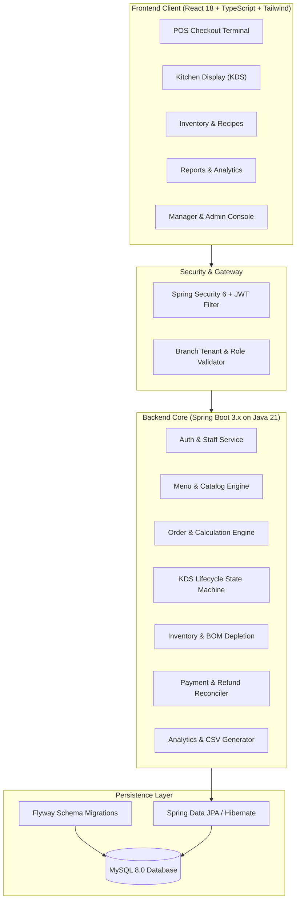

# ServeFlow POS — Commercial Restaurant Management & Point of Sale System

> **Project Repository:** Industry-Allied-Project-Team-2  
> **Target System:** Commercial-Grade Restaurant POS, Kitchen Display System (KDS), Inventory & Multi-Branch Management Platform

---

## 💡 The Idea & Vision

**ServeFlow POS** is an end-to-end, commercial-grade restaurant management and point-of-sale platform designed to streamline operations across modern dining establishments, quick-service counters, and multi-branch restaurant chains.

It bridges three critical operational pillars:
1. **Front-of-House (FOH):** Fast touch-screen billing, table reservations, split checks, multi-tender payments (Cash, Card, UPI), and customer loyalty tracking.
2. **Back-of-House (BOH):** Paperless Kitchen Display System (KDS) with color-coded preparation timers, live ticket state transitions, and real-time order bump screens.
3. **Enterprise Supply Chain & Management:** Recipe Bill of Materials (BOM) with automatic ingredient-level stock depletion upon checkout, low-stock reorder alerts, purchase orders, shift reconciliations, and streaming CSV analytics.

---

## 🛠️ Technology Stack

- **Backend:** Java 21, Spring Boot 3.x, Spring Data JPA / Hibernate, Spring Security (Stateless JWT), Bean Validation, Flyway Migrations, OpenAPI / Swagger UI, Maven.
- **Frontend:** React 18, TypeScript, Tailwind CSS, Lucide Icons, Vite.
- **Database:** MySQL 8.0 (Relational schema with ACID compliance, decimal precision for monetary values, foreign keys, and indexes).
- **DevOps:** Docker, Docker Compose, Multi-stage builds, Environment-based secrets.

---

## 🏛️ System Architecture



---

## 👥 Role-Based Access Control (RBAC) Matrix

| Module / Operation | OWNER / ADMIN | MANAGER | CASHIER | KITCHEN_STAFF | INVENTORY_STAFF |
| :--- | :---: | :---: | :---: | :---: | :---: |
| Restaurant & Branch Settings | **RW** | **RO** | — | — | — |
| Staff Management & Roles | **RW** | **RO** | — | — | — |
| Menu & Pricing Catalog | **RW** | **RW** | **RO** | **RO** | — |
| Table Management | **RW** | **RW** | **RO** | **RO** | — |
| POS Order Checkout | **RW** | **RW** | **RW** | — | — |
| Kitchen Display (KDS) | **RW** | **RW** | **RO** | **RW** | — |
| Inventory & Stock Levels | **RW** | **RW** | — | — | **RW** |
| Recipe (BOM) Setup | **RW** | **RW** | — | — | **RW** |
| Payment Collection | **RW** | **RW** | **RW** | — | — |
| Refunds & Voids | **RW** | **RW** *(Limit)* | — | — | — |
| Financial & CSV Reports | **RW** | **RW** | Shift-Only | — | — |
| Audit Trail Logs | **RO** | — | — | — | — |

*RW = Read-Write | RO = Read-Only | — = Access Restricted*

---

## 📌 Master Implementation Roadmap & Plan of Action

### Phase 0: Repository Audit & Baseline Verification
- [x] **Task 0.1: Environment & Toolchain Audit** — Verify Java 21, Maven 3.9, Node 24, npm 11, and MySQL 8.0 local runtimes.
- [x] **Task 0.2: Project Architecture & Plan Documentation** — Establish project baseline, idea definition, and comprehensive execution roadmap.
- [x] **Task 0.3: Git Hygiene Configuration** — Configure `.gitignore` to prevent secret leaks, build outputs, and node modules from being tracked.

---

### Phase 1: Requirements, Architecture & Database Design
- [x] **Task 1.1: System Architecture & Entity Modeling** — Define relational data model spanning Restaurants, Branches, Users, Menus, Tables, Orders, Payments, KDS tickets, and Inventory.
- [x] **Task 1.2: Action Plan & Milestone Specification** — Structure phased task checklists, acceptance criteria, and team distribution.
- [x] **Task 1.3: Central Documentation Setup** — Embed the entire operational blueprint inside the project README.

---

### Phase 2: Project Scaffolding, Environment Setup & Flyway Migrations
- [ ] **Task 2.1: Backend Spring Boot 3 Scaffolding**
  - Scaffold Maven Java 21 Spring Boot 3.3.x backend with Web, Data JPA, Security, and Validation starters.
  - Setup `application.yml` with dev/test profiles and environment variable overrides.
- [ ] **Task 2.2: Flyway Database Migration Baseline**
  - Create `V1__init_schema.sql` defining relational tables with primary keys, foreign constraints, decimal monetary precision, and indexes.
- [ ] **Task 2.3: Frontend React 18 + Vite Scaffolding**
  - Initialize Vite TypeScript React 18 frontend with Tailwind CSS and Lucide icons.
- [ ] **Task 2.4: OpenAPI 3 / Swagger Documentation**
  - Integrate `springdoc-openapi` for live interactive API testing at `/swagger-ui.html`.

---

### Phase 3: Authentication, Authorization & Branch Isolation
- [ ] **Task 3.1: User Entity, Roles & Password Hashing**
  - Implement `User`, `Role`, `Branch` entities with BCrypt password encryption.
- [ ] **Task 3.2: Stateless JWT Filter & Auth Endpoints**
  - Build login/token refresh endpoints and `JwtAuthenticationFilter` verifying claims, roles, and branch IDs.
- [ ] **Task 3.3: Multi-Tenant Branch Isolation**
  - Enforce tenant validation across all repository queries so staff cannot access data of other branches.
- [ ] **Task 3.4: Frontend Auth Context & Route Guards**
  - Implement login view, token persistence, and role-protected navigation routes.

---

### Phase 4: Menu Management, Dining Tables & Customers
- [ ] **Task 4.1: Category & Menu Item CRUD APIs**
  - Category, item, pricing, dietary flags, and modifier group endpoints with server-side validation.
- [ ] **Task 4.2: Dining Table Layout & Status Service**
  - Physical floor plan table management (`AVAILABLE`, `OCCUPIED`, `RESERVED`, `DIRTY`).
- [ ] **Task 4.3: Customer Profile & Loyalty Tracking**
  - Customer directory capturing phone, email, lifetime spend, and visit history.
- [ ] **Task 4.4: Frontend Menu, Table & Customer Views**
  - Management screens for catalog configuration, table layouts, and customer lookups.

---

### Phase 5: POS Billing Engine & Kitchen Display System (KDS)
- [ ] **Task 5.1: Transactional POS Order Engine (Workflow A)**
  - Server-calculated checkout (subtotals, taxes, discounts, totals). Client price values strictly ignored.
  - Idempotent order placement preventing duplicate submissions.
- [ ] **Task 5.2: Kitchen Display System (KDS) State Machine (Workflow B)**
  - Real-time ticket lifecycle: `PLACED` → `IN_PREPARATION` → `READY_FOR_PICKUP` → `SERVED` → `COMPLETED`.
  - Enforce valid transitions; reject invalid status skips.
- [ ] **Task 5.3: Frontend POS Billing Terminal UI**
  - Cashier interface with category filters, quick-tap item grid, cart drawer, tax breakdown, and payment trigger.
- [ ] **Task 5.4: Frontend Kitchen Display (KDS) Screen**
  - Live kitchen ticket cards with color-coded elapsed prep timers and 1-click status advance ("Bump").

---

### Phase 6: Inventory Tracking, Recipe Bill of Materials (BOM) & Purchasing
- [ ] **Task 6.1: Inventory & Stock Movement Engine (Workflow C)**
  - Track raw ingredients, units of measure (kg, g, L, pcs), reorder levels, and movement history (`PURCHASE`, `WASTE`, `CONSUMPTION`).
- [ ] **Task 6.2: Recipe Bill of Materials (BOM) Auto-Deduction**
  - Link menu items to raw ingredients; automatically deduct stock balances upon completed checkout.
  - Alert on low inventory and prevent invalid negative stock.
- [ ] **Task 6.3: Supplier Directory & Purchase Orders**
  - Vendor directory and purchase orders with stock replenishment on delivery receipt.
- [ ] **Task 6.4: Frontend Inventory & Purchasing Dashboard**
  - Stock level gauges, recipe builder dialog, and purchase order workflow.

---

### Phase 7: Payment Processing, Refunds & Reconciliations
- [ ] **Task 7.1: Multi-Tender Payment Recording**
  - Support Cash (with change calculator), Credit/Debit Card, UPI, and Simulated payments.
- [ ] **Task 7.2: Refund & Void Management (Workflow E)**
  - Support audited partial and full refunds with reason codes, manager authorization, and stock reversal options.
- [ ] **Task 7.3: Frontend Checkout Modal & Receipt Printing**
  - Payment settlement modal and printable thermal receipt preview with line items, tax, and totals.

---

### Phase 8: Business Analytics & High-Performance CSV Export
- [ ] **Task 8.1: Sales Aggregation & Metrics Engine (Workflow D)**
  - Calculate gross revenue, net revenue, average order value, top-selling items, and hourly rush metrics.
- [ ] **Task 8.2: Streaming CSV Export Engine**
  - Export sales, itemized orders, and inventory audits to standard CSV files with proper headers.
- [ ] **Task 8.3: Frontend Executive Analytics Dashboard**
  - Visual charts, key metric stat cards, date-range filters, and one-click CSV report downloads.

---

### Phase 9: Quality Assurance, Security Hardening & Integration Testing
- [ ] **Task 9.1: End-to-End Workflow Integration Test Suite**
  - Full-lifecycle automated tests covering Order → KDS → Checkout → Inventory Depletion → Refund.
- [ ] **Task 9.2: Security Hardening & Penetration Defense**
  - Restrictive CORS, OWASP sanitization, SQL injection defense, and RFC-7807 global exception handling.

---

### Phase 10: Dockerization, Deployment & Operations
- [ ] **Task 10.1: Multi-Stage Docker Containerization**
  - Dockerfiles for backend and frontend with `docker-compose.yml` orchestrating MySQL, API, and UI.
- [ ] **Task 10.2: Production Deployment Runbook & Backups**
  - Environment templates (`.env.example`), production setup guide, and automated database backup/restore procedures (`mysqldump`).

---

## 🚀 Local Development Quickstart

### Prerequisites
- **Java 21 LTS**
- **Apache Maven 3.9+**
- **Node.js v18+ & npm**
- **MySQL Server 8.0**

### 1. Database Initialization
```sql
CREATE DATABASE serveflow_pos CHARACTER SET utf8mb4 COLLATE utf8mb4_unicode_ci;
```

### 2. Backend Startup
```bash
cd backend
mvn clean spring-boot:run
```
- API Base: `http://localhost:8080/api`
- Swagger UI: `http://localhost:8080/swagger-ui.html`

### 3. Frontend Startup
```bash
cd frontend
npm install
npm run dev
```
- Frontend UI: `http://localhost:5173`
